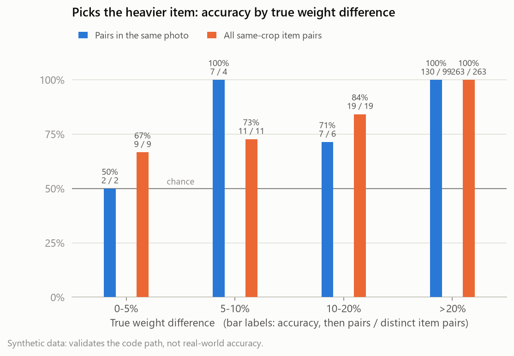
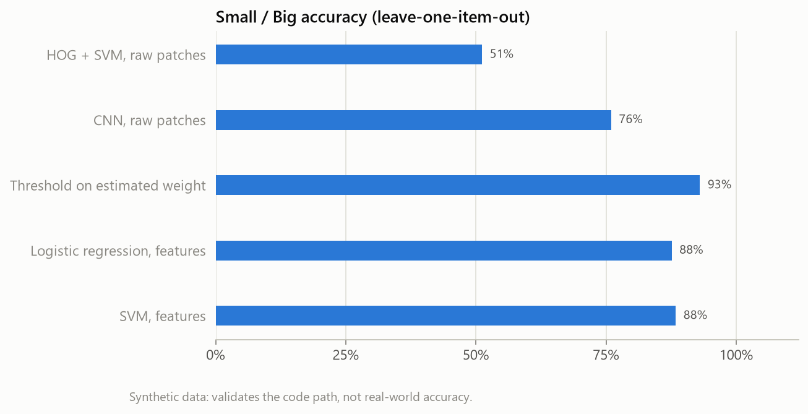

# Veggie Gauge

**Vegetable size comparison for a fixed-camera sorting station.**

A sorting-station prototype. A phone looks straight down at a white sheet, and
from one photo the system:

1. finds every vegetable;
2. measures it in millimetres;
3. identifies it as **tomato**, **kheera** (cucumber) or **chamagadda** (taro corm);
4. estimates its fresh weight in grams;
5. answers the assignment's question: of two vegetables of the same kind, which is **BIGGER**,
   which **SMALLER**, or are they **SIMILAR**. It also grades each item **SMALL / BIG** for its crop.

Items are **grouped by crop** and only compared within their group. A photo of 2 tomatoes and
3 chamagadda gives two separate comparisons, never a tomato-vs-chamagadda one.

It uses classical computer vision plus classic ML on measured features: no annotation, no
calibration marker, no GPU, no large models at inference. Design: [docs/PIPELINE.md](docs/PIPELINE.md) (v3.1).

> **Status.** The full pipeline is built and tested end to end. No real produce has been
> photographed yet (Day 1 of the plan). Every number below comes from a **synthetic dataset**
> made by `tools/synth_data.py` in the exact format of the real one. It simulates the rig, the
> three crops, a ruler photo and all four photo sets. These numbers show that the code and the
> evaluation work. They are **not** evidence of real-world accuracy, and every report generated
> from synthetic data says so.


## How it works

**Offline** (data and training):

| Stage | Code | What it does |
|---|---|---|
| 1. Weigh every vegetable | `data/ground_truth.csv` | kitchen-scale weight + ruler length per item: the only ground truth |
| 2. Fixed rig + one ruler photo | `src/calibrate.py` | mm per pixel for the fixed camera height → `data/calibration.json` |
| 3. Photograph | `data/images.csv` | singles · same-crop pairs/groups · mixed-crop photos · stress set |
| 4. Segment + extract features | `train/build_features.py` | the same code as online steps A–B, run on every photo → `data/features.csv` |
| 5. Train classic ML | `train/train_models.py` | crop classifier · per-crop weight regressor · per-crop Small/Big classifier |
| 6. Raw-image baselines | `baselines/hog_svm.py`, `baselines/cnn_patch.py` | HOG + SVM and a fine-tuned CNN on image patches, for comparison |
| 7. Evaluation | `eval/evaluate.py`, `eval/plots.py` | every metric in design §7, all leave-one-item-out |

**Online** (every photo at the sorting station, `src/pipeline.py`):

| Stage | Code | What it does |
|---|---|---|
| A. Segment | `src/segment.py` | white-balance to the sheet → saturation Otsu OR dark-vs-sheet → morphology → contours; touching items split; truncated items flagged |
| B. Features | `src/features.py` | area, perimeter, ellipse axes, length × width, elongation, solidity, hue/sat/val stats (mm via mm/px) |
| C. Classify + group | `src/crop_classifier.py`, `src/grouping.py` | crop + probability per item; probability < τ → `uncertain`, left out; the rest grouped by crop |
| D. Weight | `src/weight_model.py` | per-crop `weight = a · volume_proxy`, ± its cross-validated MAE |
| E. Decide | `src/compare.py`, `src/size_classifier.py` | per group: rank + BIGGER / SMALLER / SIMILAR (margin δ = 8%); SMALL / BIG per item |
| F. Output | `src/pipeline.py`, `app/` | JSON + annotated photo, via CLI, FastAPI or Gradio |

The volume proxy follows each crop's shape: `area^1.5` for the near-spherical tomato, and
`area × minor axis` for kheera (a cylinder lying flat) and chamagadda (an ellipsoid).

## Results on synthetic data

> Synthetic data: 43 items (15 tomato, 10 kheera, 18 chamagadda), 233 photos. These numbers show
> the system behaves as designed; they do not predict real accuracy.

| Approach | Weight MAPE | Pairwise acc. | Small/Big acc. |
|---|---|---|---|
| Raw-image HOG + SVM (baseline) | — | — | 51.2% |
| Raw-image CNN (baseline) | — | — | 76.0% |
| Features + volume proxy (this work) | 5.0% | 98.0% | 93.0% |
| Features + SVM (this work) | 5.5% | 98.0% | 88.4% |

All numbers are **leave-one-item-out**: every prediction for a vegetable comes from models that
never saw that vegetable, in any photo.

| Check | Result |
|---|---|
| Calibration (auto, one ruler photo) | 0.2499 mm/px vs a true 0.25; length error 0.6% (tomato), 2.9% (kheera), 3.2% (chamagadda) |
| Segmentation | mean IoU **0.995** vs reference outlines on 10 photos; detection count right in **100%** of photos in every set |
| Crop classifier | **100%** per item (logistic regression and kNN alike); mixed photos: 100% of items and 100% of photos grouped correctly |
| Weight, volume proxy | MAPE **5.1%** tomato · **2.5%** kheera · **6.3%** chamagadda; chosen over the multi-feature model for all three crops |
| Small / Big | threshold on estimated weight **93%**, ahead of logistic regression (88%) and SVM (88%), so the threshold is deployed |
| Stress set | touching items: 100% split, 4.9% weight MAPE · dim light: 100% crop accuracy, 6.1% MAPE · tilted camera: 12.3% MAPE (fixed calibration, expected) |
| Speed | ~100–160 ms per 1600×1200 photo on a laptop CPU (Intel, no GPU); all models together < 30 kB |

The key chart is pairwise accuracy against the true weight difference. It is near 100% for
large differences and falls toward chance for near-identical items, which is why the SIMILAR
band exists:





More charts and every number are in `reports/` (`metrics.json`, `results_table.md`, CSVs) and in
`notebooks/results.ipynb`.

**Reading these honestly.** The raw-image baselines lose to the measured features: the CNN
reaches about 76% and HOG + SVM is at chance. That matches the design's argument in §3.1. With
10–20 items per crop, an image model cannot rediscover "area" from pixels. HOG + SVM falls
*below* chance on kheera, a known leave-one-out artifact: holding out a BIG item tilts the
training labels toward SMALL. The synthetic weights follow the same shape physics as the proxy
models, so real weight errors will be higher, especially for curved kheera and lopsided
chamagadda (design §7).

## Running the project

You need **Python 3.10 or newer** on your PATH (tested on 3.11 and 3.14). Everything else
goes into a local `venv/` folder. [uv](https://docs.astral.sh/uv/) is used for faster installs
if you have it, but it isn't required.

### One command

From the repository root, in PowerShell, cmd or a macOS/Linux terminal:

```bash
python run.py
```

There's no need to activate anything first. `run.py` works through these steps and stops
with a clear message if one fails:

| Step | What happens | Time |
|---|---|---|
| setup | creates `venv/` and installs `requirements.txt` (skipped if already up to date) | first run only, a few minutes |
| data | generates the synthetic dataset, unless real data is already in `data/` | first run only, ~4 min |
| train | segments every photo, then trains the crop classifier, weight and Small/Big models | ~30 s |
| evaluate | HOG + SVM baseline, every metric, results table and charts | ~30 s |
| test | the 29 tests | ~50 s |

When it finishes, open `reports/results_table.md`, then try the demo with `python run.py demo`.

### One step at a time

| Command | What it does |
|---|---|
| `python run.py setup` | create `venv/` and install the requirements |
| `python run.py data` | synthetic dataset, unless real data is present (`--fresh` regenerates it) |
| `python run.py train` | build `data/features.csv` (plus mask overlays in `reports/overlays/`) and train the models into `models/` |
| `python run.py evaluate` | baselines, `reports/metrics.json`, `reports/results_table.md` and the charts |
| `python run.py test` | run the tests |
| `python run.py predict data/raw/mixed_0009.jpg` | analyse photos; JSON and annotated images go to `reports/demo/` |
| `python run.py demo` | Gradio demo on http://127.0.0.1:7860 |
| `python run.py api` | FastAPI service on http://127.0.0.1:8000 (interactive docs at `/docs`) |

Options:
- `--port N` changes the demo or API port.
- `--skip-tests` makes the full run skip the tests.
- `--cnn` adds the CNN baseline: `python run.py setup --cnn`, then `python run.py evaluate --cnn`.
  This installs PyTorch, about 2 GB. The CNN baseline is only for comparison and is never used
  at inference.

The default PyTorch from PyPI runs on the CPU on Windows and macOS. For an NVIDIA GPU, install
it from the PyTorch index into `venv/` first, then run with `--cnn`:

```bash
venv/Scripts/python -m pip install -r requirements-baselines.txt --index-url https://download.pytorch.org/whl/cu128
# or, with uv:  uv pip install --python venv -r requirements-baselines.txt --index-url https://download.pytorch.org/whl/cu128
```

(On macOS/Linux the interpreter is `venv/bin/python`.)

### Running the modules directly

`run.py` only calls the project's own modules, and you can run them yourself. Activate the
environment first:

```bash
venv\Scripts\Activate.ps1       # Windows PowerShell
venv\Scripts\activate.bat       # Windows cmd
source venv/bin/activate        # macOS / Linux
```

Then:

```bash
python -m tools.synth_data               # synthetic dataset + calibration in data/
python -m train.build_features           # segment every photo -> data/features.csv  (--overlays saves mask overlays)
python -m train.train_models             # crop classifier, weight and Small/Big models -> models/
python -m baselines.hog_svm              # raw-image baseline
python -m baselines.cnn_patch            # CNN baseline (needs PyTorch); --arch resnet18
python -m eval.evaluate                  # all metrics -> reports/metrics.json, reports/results_table.md
python -m eval.plots                     # charts -> reports/*.png
python -m src.pipeline data/raw/mixed_0009.jpg --out-dir reports/demo   # one photo -> JSON + overlay
python -m app.gradio_app                 # demo UI
uvicorn app.api:app --port 8000          # API: POST /compare, GET /health
python -m tools.benchmark data/raw/mixed_0009.jpg                        # CPU latency
pytest                                   # tests
```

### With your own photos

Follow [Collecting the real data](#collecting-the-real-data--3-hours) below, then run
`python run.py` again. It recognises real data (no `data/SYNTHETIC` file), never overwrites
it, and asks for `data/calibration.json` if you haven't calibrated yet. After adding more
photos, `python run.py train` and `python run.py evaluate` are enough.

### Docker

CPU only, API on port 8000. Run `python run.py` first, because the image needs `models/` and
`data/calibration.json`:

```bash
docker build -t veggie-gauge .
docker run -p 8000:8000 veggie-gauge
curl -F "file=@photo.jpg" http://localhost:8000/compare
```

### Troubleshooting

- **`python` is not found, or is older than 3.10.** Install Python from python.org. On Windows,
  `py -3.11 run.py` also works.
- **PowerShell refuses to run `Activate.ps1`.** You only need activation for the manual
  commands. Either run `Set-ExecutionPolicy -Scope CurrentUser RemoteSigned` once, or call
  `venv\Scripts\python` directly.
- **"No module named pip" inside `venv/`.** Environments created by uv come without pip;
  `run.py` installs it automatically when uv is not available.
- **A port is already in use.** Run `python run.py demo --port 7861`, or the same for `api`.
- **Starting completely fresh.** Delete `venv/`, `data/`, `models/` and `reports/`, then run
  `python run.py`.

## Collecting the real data (≈ 3 hours)

1. **Weigh** 12–15 tomatoes, 8–12 kheera and 15–20 chamagadda across a wide size range. Brush
   the soil off the chamagadda first. Mark an ID on each item's underside, then fill in
   `data/ground_truth.csv` (`veg_id,crop,weight_g,length_mm,notes`) and delete `data/SYNTHETIC`.
2. **Build the rig:** phone facing straight down at about 40 cm, zoom locked at 1×, over a plain
   white sheet, in diffuse light. Mark the position, because the height must never change.
3. **Calibrate once:** photograph a steel ruler on the sheet, then, with `venv` activated, run
   `python -m src.calibrate data/raw/ruler.jpg --points X1 Y1 X2 Y2 --mm 300`. The points are two
   tick marks read off any image viewer. Alternatively use `--auto --mm <ruler body length>`.
   Check each session with `--check data/calibration.json` on a photo of a known item.
4. **Photograph** the four sets:
   - **singles:** every item alone, 2–3 times, in different positions and rotations;
   - **pairs:** same-crop pairs and groups, many pairings;
   - **mixed:** several items of 2–3 crops together;
   - **stress:** touching items, a slight tilt, dimmer light.
5. **Record** each photo in `data/images.csv`, listing the item IDs **left to right**. That
   ordering matches detections to weights, so no annotation is needed.
6. **Optional:** trace the outlines in about 10 photos with any polygon tool (CVAT, YOLO-seg
   export) into `data/reference_masks/<photo>.txt`, for the segmentation IoU check.

The synthetic generator refuses to overwrite a `data/` folder that has no `SYNTHETIC` flag.

| File | Content |
|---|---|
| `data/ground_truth.csv` | `veg_id, crop, weight_g, length_mm, notes` |
| `data/images.csv` | `image, veg_ids` (`;`-separated, left to right), `set` (singles / pairs / mixed / stress), `case` (touching / tilt / dim), `session` |
| `data/calibration.json` | `{"mm_per_px": 0.25, "image_size": [w, h], ...}` |
| `data/features.csv` | generated: one row per detected item |
| `data/reference_masks/*.txt` | optional hand-traced outlines (YOLO-seg polygons) |

## Output

`POST /compare` and `python -m src.pipeline` return one group per crop. This is the actual
output for `data/raw/mixed_0009.jpg`, a photo of 2 tomatoes and 3 chamagadda (`bbox`, `area_mm2`
and `flags` trimmed). The true weights are tomatoes 119 g / 72 g and chamagadda 175 g / 42 g / 22 g.

```json
{
  "status": "ok",
  "mm_per_px": 0.24993,
  "groups": [
    {"crop": "tomato", "basis": "weight_g", "difference_pct": 77.3, "items": [
      {"id": 3, "crop_prob": 0.992, "length_mm": 65.2, "width_mm": 62.0, "weight_g": 118.8, "weight_err_g": 8.2,
       "rank": 1, "pairwise": "BIGGER", "absolute": "SMALL"},
      {"id": 0, "crop_prob": 0.993, "length_mm": 53.7, "width_mm": 51.2, "weight_g": 67.0, "weight_err_g": 8.2,
       "rank": 2, "pairwise": "SMALLER", "absolute": "SMALL"}],
     "adjacent": [{"higher": 3, "lower": 0, "verdict": "BIGGER", "difference_pct": 77.3}]},
    {"crop": "chamagadda", "basis": "weight_g", "difference_pct": 613.0, "items": [
      {"id": 1, "crop_prob": 0.977, "length_mm": 77.6, "width_mm": 65.4, "weight_g": 159.0, "weight_err_g": 4.5, "rank": 1, "absolute": "BIG"},
      {"id": 2, "crop_prob": 0.99, "length_mm": 53.7, "width_mm": 42.2, "weight_g": 48.9, "weight_err_g": 4.5, "rank": 2, "absolute": "BIG"},
      {"id": 4, "crop_prob": 0.992, "length_mm": 42.4, "width_mm": 34.0, "weight_g": 22.3, "weight_err_g": 4.5, "rank": 3, "absolute": "SMALL"}],
     "adjacent": [{"higher": 1, "lower": 2, "verdict": "BIGGER", "difference_pct": 225.2},
                  {"higher": 2, "lower": 4, "verdict": "BIGGER", "difference_pct": 119.3}]}
  ],
  "uncertain": [],
  "excluded": [],
  "notes": [],
  "latency_ms": 140.8
}
```

Pairwise and absolute answer different questions. The 119 g tomato is the BIGGER of the two, but
still SMALL for its crop, because the tomato threshold (the median of the bought items) is 145 g.

How the output is structured:
- A group of exactly two items gets `pairwise` BIGGER / SMALLER / SIMILAR on each item.
- A larger group gets a ranking, an `adjacent` list comparing each neighbour pair, and a note
  wherever neighbours are within δ.
- A single item gets `absolute` only.
- Items with crop probability below τ = 0.6 go to `uncertain`. Items cut off by the frame go to
  `excluded`. Neither is compared.
- If nothing is confidently identified, `status` is `no_items`.

## Decisions made while building

These go beyond, or tighten, what the design specified:

- **Every photo is white-balanced to the sheet** before colour features are measured. The sheet
  is a free white reference. Without it, dim light dropped crop accuracy to 62% on the stress
  set; with it, accuracy is 100%.
- **Touching items:** an h-maxima seed search on the distance map finds one core per item, then
  assigns each pixel to its nearest core. OpenCV's `watershed` was tried first and rejected: it
  floods by colour difference, so one marker raced around the other and touching items came out
  with about 35% weight error. A single global threshold also failed when a small item touched a
  much larger one. The seed depth (0.25) was tuned on only 11 synthetic touching photos, so
  re-check it on real produce.
- **One cross-validation module** (`train/cv.py`) produces out-of-fold predictions for every
  photo row. Training and evaluation share it, so the pairwise, mixed-photo and stress-set
  numbers are leave-one-item-out too, not just the singles.
- **Model selection:** the simplest weight model within one standard error of the best is kept.
  A learned Small/Big classifier replaces the weight threshold only if it is strictly more
  accurate. On this data neither challenger won.
- **Two pairwise views.** Random pairings rarely put near-identical items in one photo (2 pairs
  within 5%). The key chart therefore also scores every same-crop item pair, using each item's
  out-of-fold estimate, to fill in the small-difference bins. Each bin reports both the number of
  pairs and the number of *distinct item pairs*.
- **Baseline patches keep size.** Every patch covers the same physical square, sized for the
  longest kheera, and is scaled by one fixed factor. The design's "384 px without resizing" does
  not fit a 240 mm kheera at the rig's resolution; this keeps the same property (bigger item, more
  of the patch) at a size the models can use.
- **Headline-table rows:** "Features + volume proxy" uses the proxy regressor and a threshold on
  its estimate. "Features + SVM" uses the multi-feature ridge regressor and an RBF SVM on the
  mm features plus that estimate.

## Limitations

- **Fixed camera:** height, angle and zoom must not change. A tilted camera gave 12% weight error
  in the stress set. Moving the camera needs a new ruler photo.
- **Plain white background and diffuse light.** Cluttered scenes are out of scope (design §12).
- **Top-down 2D view:** height is inferred from the minor axis, so curved kheera and lopsided
  chamagadda add error.
- **The crop classifier only knows the three trained crops.** Anything else may be forced into
  one of them, and only a low probability flags it. A misclassified item joins the wrong group.
- **Small dataset** (10–20 items per crop): expect wide confidence intervals on real data.
- **No leafy crops** in this experiment (design §2 explains why).

## Repository layout

```
veggie-gauge/
├── data/                    # ground_truth.csv, images.csv, calibration.json, features.csv, raw/, reference_masks/
├── docs/                    # design document (v3.1) and data-flow diagram
├── src/
│   ├── config.py            # paths, crops, volume proxies, tunable parameters (τ, δ, …)
│   ├── calibrate.py         # ruler photo -> mm/px (manual points or automatic)
│   ├── segment.py           # white balance, threshold, morphology, touching-item split, contours
│   ├── features.py          # contour -> mm + colour features, volume proxies
│   ├── crop_classifier.py   # per-item crop type + probability
│   ├── grouping.py          # group items by crop, set aside uncertain / truncated ones
│   ├── weight_model.py      # per-crop volume-proxy regressors (+ ridge alternative)
│   ├── size_classifier.py   # per-crop SMALL / BIG: weight threshold, logistic regression, SVM
│   ├── compare.py           # per-group ranking + verdict with margin δ
│   ├── data.py              # dataset readers, left-to-right matching, IoU
│   └── pipeline.py          # end to end: image -> JSON + overlay (CLI)
├── train/                   # build_features.py, train_models.py, cv.py (leave-one-item-out)
├── baselines/               # hog_svm.py, cnn_patch.py, common.py (fixed-size patches)
├── eval/                    # evaluate.py, plots.py
├── app/                     # gradio_app.py, api.py
├── tools/                   # synth_data.py, benchmark.py
├── notebooks/results.ipynb
├── tests/                   # unit + end-to-end tests
├── models/                  # *.joblib
├── reports/                 # metrics.json, results_table.md, CSVs, charts
├── run.py                   # one script to set up and run everything
├── Dockerfile
├── requirements.txt         # runtime (CPU)
└── requirements-baselines.txt   # + PyTorch, CNN baseline only
```
