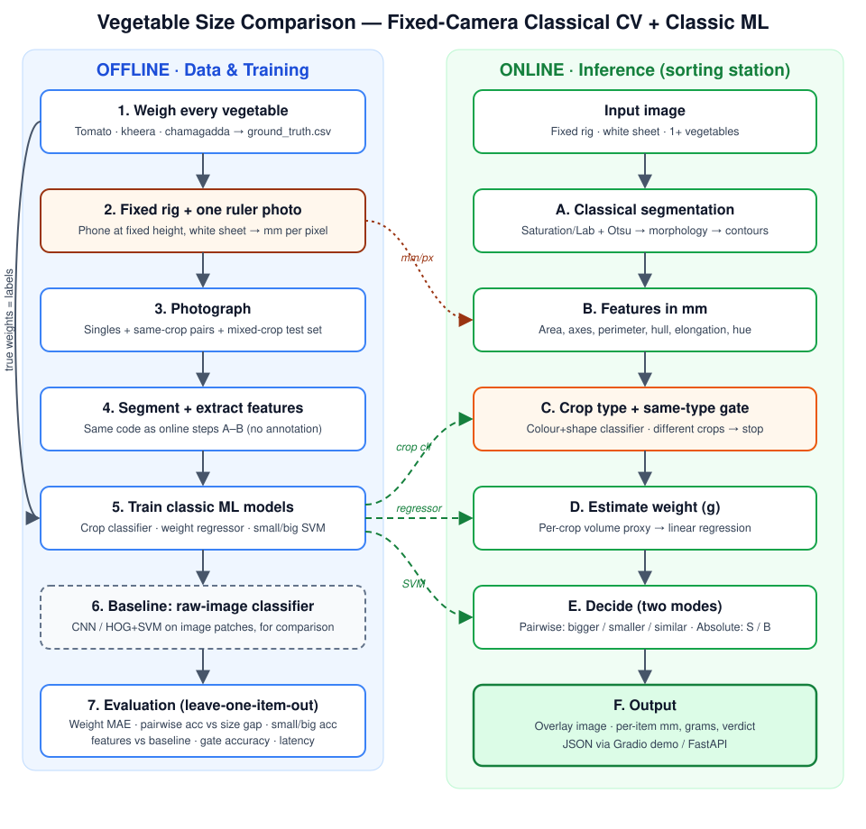
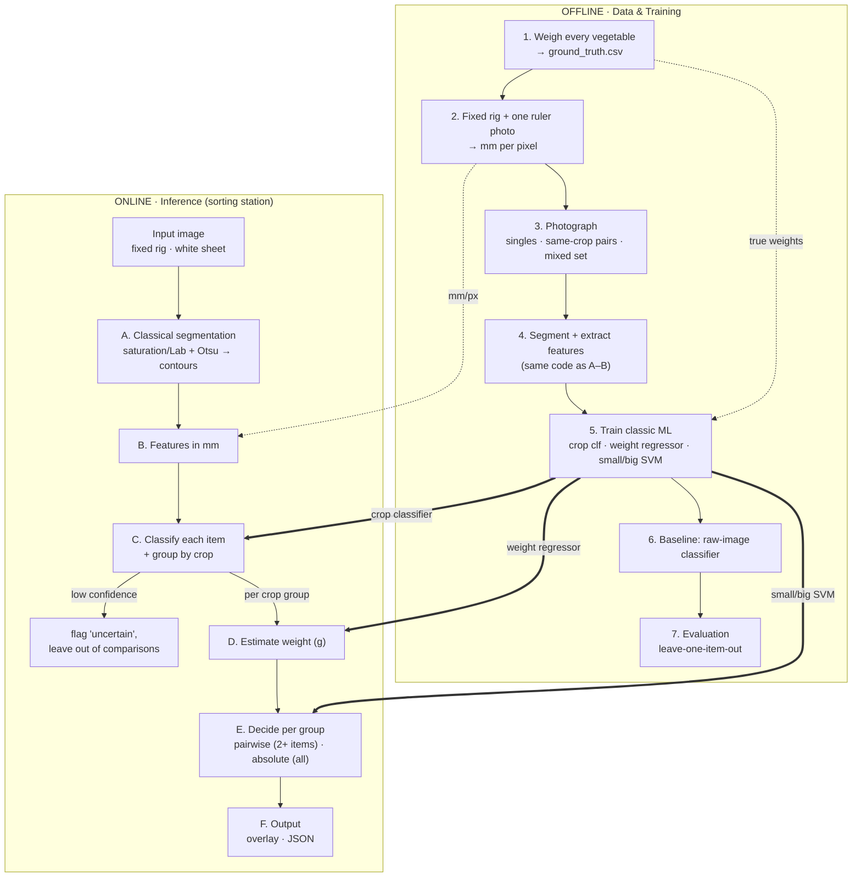

# Vegetable Size Comparison — Pipeline Design

**Candidate:** Kamal Adithya Rachuri
**Prepared for:** AgResearch Labs (ARL) — computer vision sample submission
**Date:** October 2026
**Version:** 3.1 — fixed-camera classical CV + classic ML (no annotation, no large models); mixed-crop photos grouped by crop

---

## 1. The task

> Build a model that, given two vegetables **of the same kind**, tells which one is **big** and which one is **small**.

### How this submission interprets it

| Question | Decision |
|---|---|
| What does "size" mean? | **Fresh weight (g)**, with physical dimensions (mm) as supporting measures. Produce is sold and packed by weight. |
| Relative or absolute? | **Both modes.** Pairwise: which of these is bigger. Absolute: is this one SMALL or BIG for its crop. |
| Same-vegetable constraint | Enforced by **grouping**: every item is classified by crop, and items are only ever compared with items of the same crop. A photo with 2 tomatoes and 3 chamagadda gives two separate comparisons, never a tomato-vs-chamagadda one. |
| Setup | A **fixed-camera sorting station**: phone at a fixed height and angle over a plain white sheet. This is a stated requirement, not a hidden assumption. |
| Crops tested | **Tomato**, **kheera** (cucumber) and **chamagadda** (taro / colocasia corm). |

---

## 2. Why this fits AgResearch Labs

ARL grows pesticide-free leafy greens, herbs, shoots and **roots** in sunlit aeroponic greenhouses (the Growize system). Crop growth is largely automated; **sorting and packaging are still manual**. The company values **frugal, practical, scalable** engineering.

This submission targets the manual sorting step directly:

- **A sorting-station design.** A fixed camera over a packing table is realistic, cheap and repeatable.
- **Frugal by construction.** A phone and a white sheet; CPU-only, millisecond inference; no GPU, no large models, no labelling cost.
- **Explainable.** Every verdict traces back to measured millimetres and a fitted formula, so operators and agronomists can trust it and audit it.
- **Crop coverage.**
  - **Chamagadda** represents the *roots* category ARL grows.
  - **Tomato** (round) and **kheera** (elongated) test whether the method handles very different shapes.

### Why leafy crops are not in this experiment

Leafy vegetables bought in the city are trimmed: the outer leaves are removed before sale. A trimmed head no longer represents what comes off a grow bed, so testing on it would be misleading. Section 12 explains how the pipeline extends to leafy crops (canopy density features, a side camera) once whole, untrimmed heads are available, e.g. straight from ARL's farm.

---

## 3. Key design decisions

### 3.1 Size is measured, not classified from raw pixels

With a fixed camera, 1 pixel always corresponds to the same number of millimetres, so the vegetable's outline area *is* its physical size. Computing it takes one line of code, is exact, and needs no training data.

Asking a CNN or SVM to learn big vs small from raw images instead has four problems:

1. **Tiny dataset.** With 10–20 physical items per crop, an image model memorises the specific items (colour, texture, position) rather than learning size.
2. **Shortcut learning.** It must rediscover area from a few examples and tends to latch onto colour, ripeness or background.
3. **Augmentation destroys the signal.** Standard random crop / scale augmentation zooms images in and out — the exact information needed.
4. **It doesn't answer the pairwise question.** An image-level "big/small" label can't say which of two big items is bigger.

**This idea is not discarded; it is tested.** A raw-image classifier is trained as a **baseline** (Section 5, Stage 6) and compared head-to-head with the feature-based models.

### 3.2 Classic ML on measured features

Machine learning is used where it adds value, on top of physically meaningful features:

| Model | Job | Input → output |
|---|---|---|
| Crop classifier (logistic regression / kNN) | Label every item as tomato / kheera / chamagadda so items can be grouped by crop | colour + shape features → crop + probability |
| Weight regressor, one per crop (linear regression) | Turn dimensions into grams | volume proxy → weight (g) |
| Small/Big classifier, one per crop (SVM / logistic regression) | Absolute grading | features → SMALL / BIG |

### 3.3 No annotation, no calibration marker

- **No annotation.** On a plain white sheet under a fixed camera, classical thresholding separates vegetables reliably. Crop labels come free: each training photo contains a single crop, so the photo's crop *is* the label.
- **No printed marker.** The camera height never changes, so **one ruler photo** gives mm-per-pixel once for the whole dataset.

---

## 4. Data flow



The same flow as a Mermaid diagram (renders on GitHub):



---

## 5. Offline stages

### Stage 1 — Weigh every vegetable (the labels)

| Crop | Items | Notes |
|---|---|---|
| Tomato | 12–15 | Pick a wide size range: cherry-small to large |
| Kheera | 8–12 | Mix short/thick and long/thin; they lie flat naturally |
| Chamagadda | 15–20 | Cheap and small, so buy more; brush off loose soil before weighing |

- Give each item an ID with a small sticker or a pen mark on the underside.
- Weigh it on a kitchen scale; a 1 g resolution is enough.
- Record the length with a ruler as a cross-check for calibration.

`data/ground_truth.csv`

```
veg_id,crop,weight_g,length_mm,notes
T01,tomato,96,58,
K03,kheera,212,186,slightly curved
C11,chamagadda,38,44,
```

> **Weights are the only ground truth.** Without them nobody can verify that "bigger" is correct.

### Stage 2 — Fixed rig and one-time calibration

- **Rig:** the phone, camera facing straight down, fixed at about 40 cm on a stand or a stack of books. Mark the spot so the height never changes, and lock zoom at 1×.
- **Background:** a plain **white** sheet or chart paper. White contrasts with red tomatoes, green kheera and brown chamagadda alike.
- **Lighting:** diffuse daylight or an overhead room light; avoid harsh direct sun. Shadows are grey and low-saturation, so the segmentation step rejects them.
- **Calibration:** photograph a steel ruler lying on the sheet, then measure a known span in pixels → `data/calibration.json` (`{"mm_per_px": 0.21}`).
- **Re-calibration rule:** recalibrate only if the height or the phone changes. A test photo of a known item checks the calibration each session.

### Stage 3 — Photograph

| Set | Content | Used for |
|---|---|---|
| Singles | Each item alone, 2–3 photos in different positions and rotations | Training the models; per-item feature stability |
| Same-crop pairs and groups | 2–3 items of one crop, many different pairings | Pairwise evaluation |
| Mixed-crop set | Several items of 2–3 crops together, e.g. 2 tomatoes + 3 chamagadda | Testing grouping: every item lands in the right crop group, and comparisons stay within groups |
| Stress set | Touching items, a slight tilt, dimmer light | Robustness |

- **Volume:** about 150–250 photos in total, roughly 1.5–2 hours.
- **Bookkeeping:** `data/images.csv` lists the item IDs in each photo **left to right**, which is how detections are matched to weights with no annotation.

### Stage 4 — Segment and extract features

Run online steps A–B (Section 6) on every photo and save one row per detected item to `data/features.csv`.

**Quality check:** save every mask overlay. Then hand-trace a reference mask for 10 photos with a few clicks (CVAT or any polygon tool) and report mean IoU.

### Stage 5 — Train the classic ML models

**Validation for everything:** **leave-one-item-out cross-validation.** All photos of the held-out vegetable are removed before fitting, so the model is always tested on a vegetable it has never seen.

**(a) Crop classifier**
- **Features:** mean and std of hue / saturation / value (or Lab), elongation (major ÷ minor axis), solidity.
- **Model:** logistic regression; kNN for comparison.
- **Labels:** free, from the single-crop photos.

**(b) Weight regressor, one per crop**
The key idea is a **shape-aware volume proxy**, because weight ≈ density × volume:

| Crop | Shape model | Volume proxy from a top-down view |
|---|---|---|
| Tomato | ~sphere | `area^1.5` |
| Chamagadda | ~ellipsoid | `area · minor_axis` |
| Kheera | ~cylinder lying flat | `area · minor_axis` (≈ length × width²) |

- **Primary model:** `weight = a · proxy` (plus an intercept if it helps). One or two parameters, so it's physically interpretable and hard to overfit.
- **Alternative:** a small multi-feature linear / ridge regression on log features, compared against the proxy model.
- **Metrics reported:** MAE (g), MAPE (%), R².

**(c) Small/Big classifier, one per crop (absolute mode)**
- **Labels:** BIG if the measured weight is ≥ the crop's threshold. The threshold is the median weight of the bought items, which is documented and swappable for a market or ARL grading standard.
- **Features:** the mm features plus the estimated weight.
- **Model:** SVM (RBF kernel) vs logistic regression; report both.
- **A note for the write-up:** thresholding the estimated weight is itself a strong classifier. The SVM is reported only if it beats that, so the reader sees which approach earns its place.

### Stage 6 — Baseline: raw-image classifier

This tests the alternative idea fairly:

- **Input:** a fixed-size patch (e.g. 384×384 px) cut around each item **without resizing**, so the size information is preserved. That is the most favourable setup possible for the baseline.
- **Models:**
  - HOG features + SVM (classic)
  - a fine-tuned ResNet-18 / MobileNetV3, with augmentations limited to flips, rotations and colour jitter (no scale or crop)
- **Same leave-one-item-out splits and same labels** as Stage 5c.
- **The result goes in the results table either way.**

### Stage 7 — Evaluation

See Section 7.

---

## 6. Online stages (inference)

### A. Classical segmentation

1. Convert to HSV (or Lab). Vegetables have high saturation or low lightness against white; shadows are grey and low-saturation, so they drop out.
2. Otsu threshold on the saturation channel, combined with a lightness threshold for the dark brown chamagadda.
3. Morphology:
   - open to remove specks and the fine hairs on chamagadda
   - close to fill gaps
   - fill holes
4. Contours, keeping those above a minimum area.
5. **Touching items:** a distance transform plus watershed splits them.
6. **Flag** contours touching the image border (truncated items).

### B. Features (per contour, converted to mm via `mm_per_px`)

| Feature | Used for |
|---|---|
| `area_mm2`, `perimeter_mm` | Size |
| `major_mm`, `minor_mm` (ellipse fit / min-area rectangle) | Size, volume proxy |
| `elongation = major / minor` | Crop type (kheera ≫ tomato) |
| `solidity = area / hull_area` | Crop type, irregularity |
| `hue_mean`, `sat_mean`, `val_mean` (+ std) | Crop type |

### C. Classify each item and group by crop

Each detected item is classified on its own, so a photo may contain any mix of crops.

1. The crop classifier gives every item a crop label and a probability.
2. Items with probability < τ are marked `"uncertain"`, shown in the overlay, and **left out of all comparisons**.
3. The remaining items are **grouped by crop**. Each group is processed independently in steps D–E.

| Group size | What happens |
|---|---|
| 2 or more items | Pairwise ranking within the group + absolute SMALL / BIG for each item |
| 1 item | Absolute SMALL / BIG only; noted as "no same-crop partner in this photo" |
| 0 items (everything uncertain) | `"no confidently identified vegetables"` |

Items of different crops are **never compared with each other**. This is how the "same vegetable" rule is enforced without rejecting mixed photos.

### D. Estimate weight

Apply the crop's regressor → `weight_g`, with the cross-validated MAE attached as `± error`.

### E. Decide (per crop group, two modes)

**Pairwise mode** (groups with 2+ items):
- Rank the group's items by estimated weight: 1st = biggest.
- For each adjacent pair in the ranking, a relative difference greater than δ → **BIGGER / SMALLER**.
- A difference of δ or less → **SIMILAR**. δ is tuned on validation data; start at 8%.
- With 2 items this gives the BIGGER / SMALLER answer directly; with 3+ items it gives a full ranking.

**Absolute mode** (every confidently identified item):
- The crop's Small/Big classifier labels each item **SMALL** or **BIG**.

### F. Output

Example for a photo with 2 tomatoes and 3 chamagadda:

```json
{
  "groups": [
    {
      "crop": "tomato",
      "items": [
        {"id": 0, "weight_g": 118, "weight_err_g": 9, "rank": 1, "pairwise": "BIGGER", "absolute": "BIG"},
        {"id": 3, "weight_g": 74, "weight_err_g": 9, "rank": 2, "pairwise": "SMALLER", "absolute": "SMALL"}
      ]
    },
    {
      "crop": "chamagadda",
      "items": [
        {"id": 1, "weight_g": 52, "weight_err_g": 6, "rank": 1, "absolute": "BIG"},
        {"id": 4, "weight_g": 49, "weight_err_g": 6, "rank": 2, "absolute": "BIG", "note": "SIMILAR to rank 1"},
        {"id": 2, "weight_g": 31, "weight_err_g": 6, "rank": 3, "absolute": "SMALL"}
      ]
    }
  ],
  "uncertain": []
}
```

The demo shows the photo with contours, IDs, dimensions, weights and verdicts drawn on it.

---

## 7. Evaluation plan

All numbers use **leave-one-item-out** splits.

| Component | Metric |
|---|---|
| Calibration | Length error (mm) vs ruler, per crop |
| Segmentation | Mean IoU on 10 hand-traced photos; overlays for everything else |
| Crop classifier / grouping | Per-item crop accuracy and confusion matrix; on the mixed-crop set, % of items placed in the correct group and % of photos with every item grouped correctly |
| Weight regressor | MAE (g), MAPE (%), R² — proxy model vs multi-feature model |
| Pairwise decision | Accuracy vs true weight order — overall, and **binned by true weight difference** (0–5%, 5–10%, 10–20%, >20%) |
| Absolute Small/Big | Accuracy, F1, confusion matrix — weight threshold vs SVM vs logistic regression |
| Baseline comparison | The same Small/Big metrics for HOG+SVM and CNN on raw patches |
| Robustness | Accuracy on the stress set (touching items, tilt, dim light) |
| Efficiency | CPU latency per image (ms) |

**Headline results table (to be filled in):**

| Approach | Weight MAPE | Pairwise acc. | Small/Big acc. |
|---|---|---|---|
| Raw-image HOG + SVM (baseline) | — | — | ? |
| Raw-image CNN (baseline) | — | — | ? |
| Features + volume proxy (this work) | ? | ? | ? |
| Features + SVM (this work) | ? | ? | ? |

**Key chart:** pairwise accuracy against true weight difference. It should be near 100% for large differences and fall toward 50% for near-identical items. That is why the SIMILAR band exists.

**Expected, and stated up front:**
- Kheera weight error will depend on curvature: a curved kheera's top-down view underestimates its length.
- Chamagadda's irregular shapes and hairs will add noise.
- Both will be reported per crop rather than averaged away.

---

## 8. Deployment

- **Demo:** Gradio app — upload a photo, get the annotated image plus the results table.
- **API:** FastAPI `POST /compare` → JSON as above.
- **Dependencies:** OpenCV, NumPy, scikit-learn, Gradio, FastAPI. PyTorch is used only for the CNN baseline, not at inference.
- **Packaging:** Dockerfile; pinned `requirements.txt`; models saved with `joblib`.
- **Performance:** CPU inference in milliseconds; runs on a laptop or a Raspberry Pi-class device.
- **Reproducibility:** fixed seeds, saved splits, and one command each to train, evaluate and launch the demo.

---

## 9. Repository layout

```
veg-size-compare/
├── data/
│   ├── raw/                 # photos
│   ├── ground_truth.csv     # weighed items
│   ├── images.csv           # photo → item IDs, left to right
│   ├── calibration.json     # mm per pixel at the fixed height
│   └── features.csv         # generated
├── src/
│   ├── calibrate.py         # ruler photo → mm/px
│   ├── segment.py           # threshold, morphology, watershed, contours
│   ├── features.py          # contour → mm features
│   ├── crop_classifier.py   # per-item crop type + probability
│   ├── grouping.py          # group items by crop, set aside uncertain ones
│   ├── weight_model.py      # per-crop volume-proxy regressors
│   ├── size_classifier.py   # per-crop small/big SVM / logistic regression
│   ├── compare.py           # per-group ranking + verdict with margin δ
│   └── pipeline.py          # end-to-end: image → JSON
├── baselines/
│   ├── hog_svm.py
│   └── cnn_patch.py
├── eval/
│   ├── evaluate.py          # all metrics in Section 7
│   └── plots.py
├── app/
│   ├── gradio_app.py
│   └── api.py
├── notebooks/results.ipynb
├── Dockerfile
├── requirements.txt
└── README.md
```

---

## 10. Timeline (≈ 3–4 days)

| Day | Work |
|---|---|
| 1 | Buy and weigh produce, build the rig, take the ruler photo and all photos (≈ 3 h). In parallel: segmentation, feature and calibration code |
| 2 | Feature extraction on all photos; crop classifier, weight regressors, small/big models; pairwise logic |
| 3 | Baselines (HOG+SVM, CNN), full evaluation and plots |
| 4 | Gradio demo, FastAPI, Docker, README and results write-up |

---

## 11. Assumptions and limitations

- **Fixed camera** height, angle and zoom. Moving the camera requires a new ruler photo.
- **Plain white background and diffuse light.** Cluttered scenes are out of scope for this version (see Section 12).
- **Top-down 2D view.** Height is inferred from the minor axis, which assumes items lie in a natural, stable pose. A curved kheera or a lopsided chamagadda adds error.
- **Small dataset** (10–20 items per crop) means wide confidence intervals; these are reported, not hidden.
- **Crop scope:** the classifier knows only the three trained crops; anything else is flagged as uncertain.
- **Grouping errors propagate:** a misclassified item joins the wrong group and gets compared with the wrong crop. The three crops differ strongly in colour and shape, so this should be rare; the mixed-crop set measures how rare.
- **Touching items of different crops** can merge into one contour. Watershed usually splits them; keeping items slightly apart avoids the problem.
- **No leafy crops tested** (Section 2).

---

## 12. Future scope (fit with ARL operations)

1. **Leafy crops:** test on untrimmed heads from the farm. Add canopy density (`area / hull_area`) and a **side camera** for head height, since a top-down silhouette alone misses volume for leafy produce.
2. **Packing-line grading:** sort into weight bands for consistent pack weights.
3. **Uncontrolled photos** (greenhouse beds, cluttered backgrounds): swap classical segmentation for zero-shot detection + SAM, then distil it into a small YOLO segmenter using the auto-generated masks as free labels.
4. **Low-cost depth sensor:** direct volume measurement instead of inferring it from a 2D shape.
5. **Dashboard integration:** stream per-batch size statistics into the existing remote-monitoring stack.
6. **Quality checks:** reuse the colour features for ripeness, blemish and wilting detection.

---

## 13. References

- Ponce et al., *Automatic Counting and Individual Size and Mass Estimation of Olive-Fruits Through Computer Vision Techniques*, IEEE Access 7 (2019). Classical segmentation in a controlled imaging chamber, with features regressed against reference measurements; the same architecture as this submission.
- *Automated Grading System for Sweet Potato*, ACRS 2023. Object position recognition plus scale conversion for size.
- *Tomato Grading System with Computer Vision*, ACRS 2020. OpenCV-based size measurement for grading.
- Otsu, *A Threshold Selection Method from Gray-Level Histograms*, IEEE Trans. SMC (1979).
- AgResearch Labs: https://agresearchlabs.com (Tech, About Us pages); Greenlyfe: https://www.greenlyfe.in
